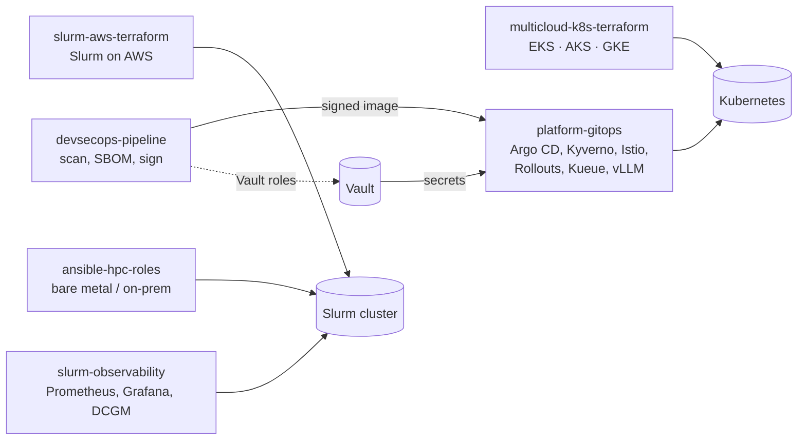

## Hi, I'm Ahmed Darwish 👋

**Senior HPC DevOps Engineer** · Alexandria, Egypt · open to freelance, part-time and full-time remote work

I build and automate the infrastructure that research and AI teams run on: HPC clusters with
Slurm, bare-metal provisioning with xCAT and MAAS, and Kubernetes platforms on AWS, Azure and GCP,
all as code and with security built in.

- 🖥️ **HPC:** Slurm (scheduling, accounting, GPU partitions), xCAT and MAAS provisioning, Ansible at cluster scale
- ☁️ **Cloud & Kubernetes:** AWS, GCP, Azure, DigitalOcean · EKS, GKE, AKS · migrations to Kubernetes
- 🧱 **Infrastructure as code:** Terraform, Ansible, GitOps with Argo CD
- 🔐 **DevSecOps:** secure CI/CD, policy as code, image signing, secrets management
- 👥 Led a DevOps team: CI/CD standards, IaC and container best practices, mentoring

### Projects

Lab projects and reference implementations. Every repository is validated in CI on each push
(see the badge in each README); deploying them creates billable cloud resources.

| Project | What it shows |
|---|---|
| [slurm-aws-terraform](https://github.com/Engdarwish2019/slurm-aws-terraform) | Slurm cluster on AWS with Terraform: configless Slurm, accounting, EFS, GPU partition, SSM-only access. Self-draining node health checks (ECC, XID, row remapping), NCCL and HPL benchmarks (HPL runs in CI), EC2 auto-recovery and alerting |
| [ansible-hpc-roles](https://github.com/Engdarwish2019/ansible-hpc-roles) | Ansible roles for EL9 clusters: Slurm, MUNGE, NFS, Lmod, NVIDIA drivers with a DCGM diagnostic gate, hardening and xCAT bare-metal provisioning |
| [slurm-observability](https://github.com/Engdarwish2019/slurm-observability) | Prometheus, Alertmanager and Grafana for Slurm and GPUs, with unit-tested alert rules and DCGM metrics from one host engine per node |
| [multicloud-k8s-terraform](https://github.com/Engdarwish2019/multicloud-k8s-terraform) | One secure Kubernetes baseline on EKS, AKS and GKE with GPU pools, offline `terraform test` suites, GitHub Actions and Azure DevOps pipelines, OIDC only (no stored keys) |
| [platform-gitops](https://github.com/Engdarwish2019/platform-gitops) | Internal developer platform on Argo CD: Kyverno, Crossplane, Backstage, Argo Rollouts canaries, Istio ambient mTLS, External Secrets with Vault, Kueue GPU queues, vLLM on GPUs |
| [devsecops-pipeline](https://github.com/Engdarwish2019/devsecops-pipeline) | Secure supply chain: gitleaks, Semgrep, Trivy, SBOM, ZAP, Cosign keyless signing, SLSA provenance, Vault, Falco, every action pinned to a commit |

### How the projects fit together

Terraform builds the clusters, Argo CD runs the platform on them, and the DevSecOps pipeline
produces the signed image the platform verifies before admitting it and ships as a canary. On the
HPC side, the same Slurm node health check and GPU monitoring are used on AWS and on bare metal.

### Skills by area

| Area | Where to see it |
|---|---|
| **Kubernetes & Terraform** | Cluster builds on three clouds, Terraform modules with offline tests, Kubernetes manifests validated against their schemas in CI |
| **Multi-cloud** | AWS (VPC, EKS, EFS, KMS, SSM, CloudWatch, EventBridge), Azure (AKS, Entra ID, workload identity), GCP (GKE, Binary Authorization, Workload Identity); GitHub Actions and Azure DevOps with OIDC |
| **Platform engineering** | Argo CD app of apps, Argo Rollouts with Prometheus analysis, Crossplane self-service APIs, Kyverno policies with tests, Backstage golden path, Prometheus and OpenTelemetry |
| **DevSecOps** | SAST, DAST, image and IaC scanning, SBOM, Cosign and SLSA provenance, Vault (Agent injector and External Secrets), Falco, Istio mTLS, NetworkPolicies, pinned supply chain |
| **HPC / AI infrastructure** | Slurm, Ansible, xCAT, NVIDIA drivers and DCGM, NCCL tests, HPL, GPU node health, vLLM serving, Kueue GPU quotas |

### Tech stack

### Focus for 2026–2027

Kubernetes administration and security (CKA, then CKS), platform engineering (Argo CD,
Crossplane, Backstage) and GPU / AI infrastructure (NVIDIA AI Operations and AI Infrastructure).

### Connect

